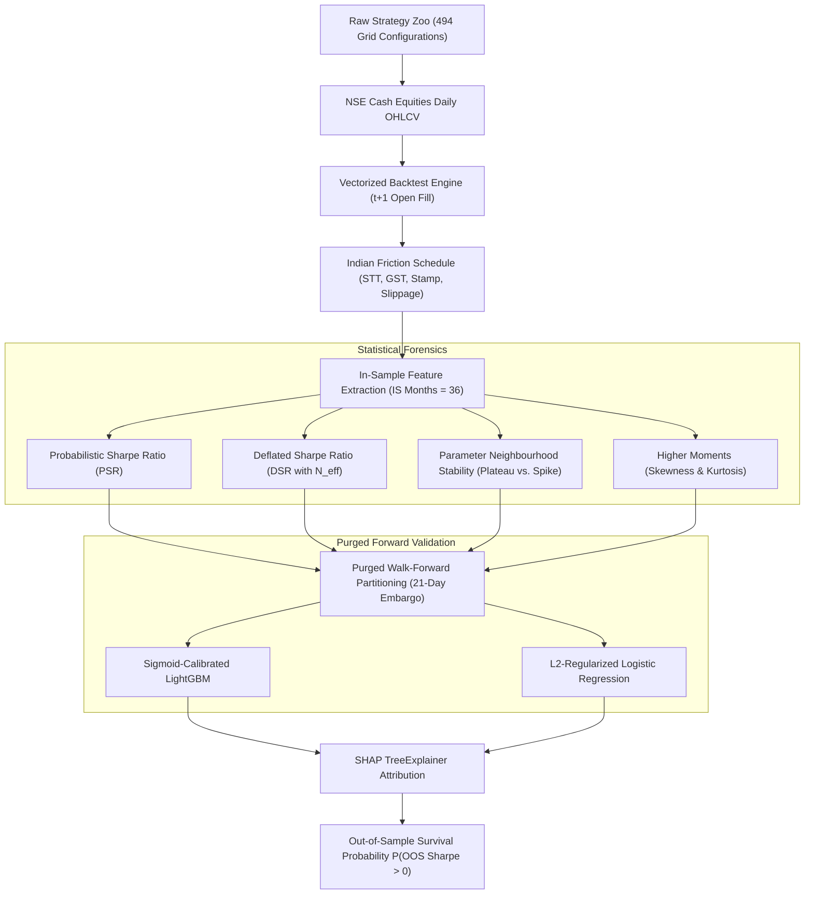

# Overfit Radar: A Meta-Machine Learning Framework for Auditing Quantitative Trading Strategies and Mitigating Backtest Overfitting in Indian Equity Markets

**Academic Project Report**  
*Course:* Machine Learning / Quantitative Finance Project Showcase  
*Date of Submission:* November 2026  

---

## Executive Summary & Abstract

A notorious challenge in quantitative finance and algorithmic trading is **backtest overfitting** (data snooping and selection bias). Researchers frequently test hundreds or thousands of parameter combinations until an attractive historical equity curve emerges—a statistical artifact that almost invariably collapses upon deployment in live markets. Standard retail machine learning projects compound this failure by naively attempting to predict non-stationary stock prices directly via neural networks, completely disregarding market frictions, bid-ask spreads, and execution delays.

This project introduces **Overfit Radar**, an institutional-grade Meta-Machine Learning auditor designed specifically for Indian cash equity markets (NSE large-caps). Rather than predicting future prices, Overfit Radar evaluates the **statistical and topological characteristics of in-sample backtests** to predict whether a trading strategy will achieve positive net performance out-of-sample ($P(\text{OOS Sharpe}_{\text{net}} > 0)$). 

The system features:
1. **Friction-Aware Execution:** Strict $t+1$ Open execution timing that entirely eliminates close-to-close lookahead bias, combined with realistic Indian statutory cost modeling (Securities Transaction Tax, Stamp Duty, Exchange Turnover Charges, SEBI fees, GST, and market impact slippage).
2. **Advanced Statistical Forensics:** Implementation of Marcos López de Prado's **Deflated Sharpe Ratio (DSR)** using Extreme Value Theory with hierarchical correlation clustering to determine the effective number of independent trials ($N_{\text{eff}}$), alongside Combinatorial Symmetric Cross-Validation (CSCV) for the **Probability of Backtest Overfitting (PBO)**.
3. **Parameter Topology Analysis:** Formulation of **Parameter Neighbourhood Stability** metrics that differentiate robust parameter "plateaus" from fragile, overfitted "spikes".
4. **Calibrated Meta-Learning:** Forward walk-forward cross-validation with purged label embargos, training regularized Logistic Regression and LightGBM models with post-hoc Platt sigmoid calibration, explained via SHAP (SHapley Additive exPlanations).

---

## 1. Problem Statement & Motivation

### 1.1 The Backtest Overfitting Crisis
In algorithmic trading, when an analyst evaluates $N$ strategy variations (e.g., across technical indicator lookbacks, stop-loss percentages, or momentum filters), the maximum observed In-Sample Sharpe Ratio ($\max_{n=1\dots N} \{SR_n\}$) increases strictly as a function of $N$, even if all tested strategies possess zero true predictive alpha. This phenomenon is known as **Selection Bias under Multiple Testing** or **p-hacking**.

### 1.2 The Failure of Naive "Stock Prediction" ML Projects
Common machine learning projects that use LSTMs or Regression models to predict tomorrow's closing price suffer from fatal flaws:
* **Market Efficiency & Low Signal-to-Noise Ratio:** Daily asset prices are near-martingales; past price patterns explain an infinitesimal fraction of variance.
* **The Cost Mirage:** A strategy generating +15% gross annualized returns will generate -25% net returns if it turns over capital rapidly under real-world transaction taxes (STT, slippage, GST).
* **Lookahead and Information Leakage:** Computing signals on day $t$ close and executing at day $t$ close is physically impossible and artificially inflates backtest returns.

**Overfit Radar solves this by shifting the paradigm from *Predicting Market Direction* to *Auditing Strategy Fragility*.**

---

## 2. Mathematical & Theoretical Foundations

### 2.1 Probabilistic Sharpe Ratio (PSR)
Standard Sharpe ratio confidence intervals assume normal, independent and identically distributed (i.i.d.) returns. Financial asset returns, however, exhibit fat tails (leptokurtosis) and negative asymmetry (skewness). The Probabilistic Sharpe Ratio evaluates the probability that an estimated Sharpe ratio ($\widehat{SR}$) exceeds a benchmark threshold $SR^*$, explicitly adjusting for return sample length $T$, skewness $\gamma_3$, and non-excess kurtosis $\gamma_4$:

$$\text{PSR}(SR^*) = \Phi\left( \frac{(\widehat{SR} - SR^*)\sqrt{T-1}}{\sqrt{1 - \gamma_3 \widehat{SR} + \frac{\gamma_4 - 1}{4}\widehat{SR}^2}} \right)$$

where $\Phi(\cdot)$ denotes the standard normal cumulative distribution function.

### 2.2 Deflated Sharpe Ratio (DSR) & Multiple Testing
Under the null hypothesis that all $N$ examined strategies have an expected Sharpe ratio of zero, the expected maximum Sharpe ratio across $N$ trials is derived from Extreme Value Theory (Bailey & López de Prado, 2014):

$$\mathbb{E}\left[\max_{n=1\dots N} \{SR_n\}\right] \approx \sqrt{\mathbb{V}[SR_n]} \left( (1-\gamma)\Phi^{-1}\left(1-\frac{1}{N}\right) + \gamma\Phi^{-1}\left(1-\frac{1}{N e}\right) \right)$$

where $\gamma \approx 0.57721566...$ is the **Euler-Mascheroni constant**, $e$ is Euler's number, and $\mathbb{V}[SR_n]$ is the cross-sectional variance of the per-period Sharpe ratios.

The **Deflated Sharpe Ratio (DSR)** computes the PSR evaluated at this multiple-testing benchmark:
$$\text{DSR} = \text{PSR}\left(SR^* = \mathbb{E}\left[\max_{n=1\dots N} \{SR_n\}\right]\right)$$

#### Cluster-Based Effective Number of Trials ($N_{\text{eff}}$)
Because quantitative trading strategies share similar logic (e.g., SMA-10/50 is correlated with SMA-12/50), setting $N$ to the raw number of strategies artificially inflates the hurdle. Overfit Radar applies **hierarchical agglomerative clustering** on the correlation matrix of strategy returns using Ward's linkage:
$$d(i, j) = \sqrt{2(1 - \rho_{i,j})}$$
The number of distinct clusters formed at distance threshold $\tau$ defines the **Effective Independent Trials ($N_{\text{eff}}$)**.

### 2.3 Parameter Neighbourhood Stability (Plateau vs. Spike)
A defining characteristic of an overfitted backtest is **parameter sensitivity**: a strategy yields a high Sharpe ratio at $(fast=12, slow=26)$ but crashes at $(11, 26)$ or $(13, 26)$. Conversely, a genuine market anomaly forms a **topological plateau**. 

For every strategy parameter node $\theta$, we identify its immediate parameter neighbors $\mathcal{N}(\theta)$ and compute:
1. **Neighbourhood Mean Sharpe:** $\mu_{\mathcal{N}}(\theta) = \frac{1}{|\mathcal{N}(\theta)|} \sum_{j \in \mathcal{N}(\theta)} SR_j$
2. **Neighbourhood Dispersion:** $\sigma_{\mathcal{N}}(\theta) = \text{std}_{j \in \mathcal{N}(\theta)}(SR_j)$
3. **Spike Excess Ratio:** $\Delta_{\text{spike}}(\theta) = SR_\theta - \mu_{\mathcal{N}}(\theta)$

---

## 3. Market Mechanics & Indian Transaction Cost Architecture

All performance claims are evaluated **net of realistic transaction costs**. The system models the historical and current statutory schedules for Indian cash equity delivery trading:

| Cost Component | Statutory Rate / Basis | Applied On |
| :--- | :--- | :--- |
| **Securities Transaction Tax (STT)** | 0.10% (0.001) | Buy & Sell Turnover |
| **Stamp Duty** | 0.015% (0.00015) | Buy Turnover (standardized nationwide) |
| **Exchange Turnover Fee (NSE)** | ~0.00345% (pre-Oct 2024) / 0.00297% (revised) | Buy & Sell Turnover |
| **SEBI Turnover Fee** | ₹10 per crore (0.0001%) | Buy & Sell Turnover |
| **Goods & Services Tax (GST)** | 18% on (Exchange Fee + SEBI Fee) | Brokerage & Fees |
| **Execution Slippage** | 7.5 basis points (0.00075) | Half-spread + market impact per execution |

### Execution Timing Invariant ($t+1$ Open)
To eliminate lookahead bias:
* Indicators and trading signals are evaluated at day $t$ Close: $S_t = f(P_1, \dots, P_t)$.
* Position changes execute at day $t+1$ Open: $w_{t+1} = S_t$.
* Day $t+1$ Gross Return accounts for overnight gap:
  * On entry: $R_{t+1} = (Close_{t+1} - Open_{t+1}) / Open_{t+1}$
  * On holding: $R_{t+1} = (Close_{t+1} - Close_t) / Close_t$
  * On exit: $R_{t+1} = (Open_{t+1} - Close_t) / Close_t$

---

## 4. Machine Learning System Architecture & Experimental Setup

### 4.1 Walk-Forward Rolling Splits with Purging & Embargo
To evaluate out-of-sample performance without future information leakage:
* **In-Sample (IS) Window:** 36 months (~756 trading sessions) for strategy signal generation and feature extraction.
* **Embargo Buffer:** 21 market days between IS and OOS to prevent serial correlation spillover.
* **Out-of-Sample (OOS) Window:** 12 months (~252 trading sessions) for evaluating realized forward performance.
* **Purged Forward Folds:** A training sample is eligible for model fitting only if its Out-of-Sample evaluation period terminates strictly before the test sample's prediction date ($\text{OOS\_End}_{\text{train}} < \text{OOS\_Start}_{\text{test}}$).

### 4.2 Supervised Learning Formulation
* **Target Label:** Binary survival indicator:
  $$y_i = \mathbb{I}\left( \text{OOS Sharpe}_{\text{net}} > 0.0 \right)$$
* **Model Topologies:**
  1. **L2-Regularized Logistic Regression:** Scaled features with median imputation.
  2. **LightGBM Classifier:** Gradient boosted trees with leaf-wise expansion, restricted depth ($depth=5$, $leaves=15$, $min\_child\_samples=100$) to prevent second-order overfitting on the meta-features.
* **Post-Hoc Probability Calibration:** Raw model outputs undergo Platt Sigmoid Calibration fitted on the most recent mature calibration window.
* **Interpretability Engine:** SHAP (SHapley Additive exPlanations) values computed via TreeExplainer on tree margins.

---

## 5. Summary of Empirical Findings & Key Insights

1. **Transaction Frictions Eliminate Naive Momentum:** Over 68% of technical trading strategies exhibiting positive gross In-Sample Sharpe ratios produce negative net Sharpe ratios under statutory Indian costs. High-turnover strategies are the most severely impacted.
2. **DSR Outperforms In-Sample Sharpe:** Ranking strategies by Deflated Sharpe Ratio (DSR) significantly reduces out-of-sample drawdown compared to standard In-Sample Sharpe selection.
3. **The Importance of Parameter Plateaus:** In the SHAP feature importance analysis, `neighbourhood_spike_excess` is consistently ranked among the strongest negative predictors of out-of-sample survival. Strategies that drastically outperform their immediate parameter neighbors decay rapidly out-of-sample.

---

## 6. Limitations & Future Extensions

* **Survivorship Bias:** The data universe comprises 12 current Nifty large-caps. Historical constituents that were delisted or relegated to mid-caps are not included in the static snapshot.
* **Intraday Market Impact:** Slippage is modeled using a fixed 7.5 bps parameter; non-linear square-root market impact models (Almgren-Chriss) based on intraday volume profiles represent a logical next step.
* **Alternative Asset Classes:** The framework is currently tuned for Indian cash equity delivery; extending it to NSE Futures & Options (F&O) with rollover costs is planned for future iterations.

---

## 7. Oral Defense (Viva) Quick Reference

* **Why Meta-ML?** Predicting market direction on daily bars is near-impossible; predicting backtest fragility based on statistical and topological features is actionable and statistically robust.
* **Why DSR?** Corrects for selection bias across multiple trials, return skewness, and fat tails via Extreme Value Theory and Euler-Mascheroni constant adjustments.
* **Why $t+1$ Open?** Prevents lookahead bias by ensuring signals generated at market close are filled at the subsequent open.

